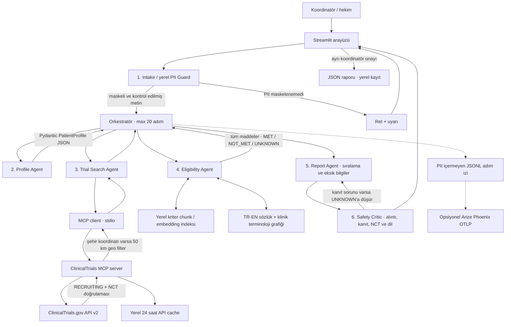

# Mimari

## Önerilen mimariyle eşleme

| Önerideki parça | Bu projedeki karşılığı |
|---|---|
| Koordinatör / hekim ve onay | Streamlit profil önizlemesi, rapor ve açık kayıt onayı |
| Orkestratör + 6 uzman | Intake/PII Guard, Profile, Search, Eligibility, Report, Safety Critic |
| Kendi ClinicalTrials MCP server + MCP client | `trialmatch/mcp_server.py`, `trialmatch/mcp_client.py`; stdio alt-süreç |
| Kriter = chunk, hibrit arama | `split_eligibility_criteria` her kaynak maddesini chunk yapar; sözlük/lexical + isteğe bağlı E5 embedding; bütün kriterler değerlendirilir |
| Yerel indeks / cache | Kamuya açık API kayıtları için 24 saatlik JSON cache; E5 etkinse model adıyla ayrılmış JSON vektör indeksi |
| Güvenlik critic | NCT allowlist, birebir kaynak alıntısı, hasta kanıtı ve kesinlik dili denetimi; riskli kararlar UNKNOWN'a indirilir |
| Trace ve maliyet/gecikme | PII'siz `traces.jsonl`; adım süresi, token sayısı ve maliyet. LLM kullanılmadığı için token ve maliyet 0 |
| Yazma HITL | `save_report` onay parametresi olmadan dosya yazmaz |

## Güven sınırları ve veri akışı

1. Ham metin önce yerelde maskelenir. Tanınan PII kalırsa işlem reddedilir. Bu
   regex tabanlı guard tüm olası tanımlayıcıları yakalamayı garanti etmez;
   yalnızca sentetik/kurgusal veri kullanılmalıdır.
2. Profil yalnızca maskeli metinden çıkarılır; bulunmayan alanlar `null` veya
   `unknown` kalır. Hasta ve ClinicalTrials metinlerindeki talimat benzeri
   ifadeler veri kabul edilir.
3. Search Agent yalnızca MCP client üzerinden arar. MCP server ClinicalTrials
   API v2'yi çağırır, `NCT` biçimini doğrular ve ayrı çalışma ayrıntısını tekrar
   getirir. Varsayılan durum `RECRUITING`'dir.
4. Bilinen şehirler için merkez noktası kullanılarak 50 km API filtresi
   uygulanır; API döndürdüğü `geoPoint` varsa en yakın merkez hesaplanıp
   sonuçlar sıralanır. Konum/koordinat bilinmiyorsa mesafe uydurulmaz.
5. Kriter getirici yalnızca işlem sırasını iyileştirir; hiçbir kriteri
   atlamaz. Yaş/cinsiyet yapılandırılmış alanlardan kontrol edilir. Klinik
   belirsizlikte `UNKNOWN` kullanılır.
6. Bilgi grafiği ilaç sınıfı/terim eşlemesini destekler; tek başına biyobelirteç
   bilgisi tedavi öyküsü varmış gibi yorumlanmaz.
7. Safety Critic; NCT, kaynak alıntısı, profil kanıtı ve dil kontrollerini
   yapar. Trace'e metin, alıntı, tanı, lokasyon veya PII yazılmaz.
8. Kayıt, ekranda koordinatörün ayrı onayı olmadan yapılmaz.

## Çalıştırma izleri

Adım izleri varsayılan olarak `data/cache/traces.jsonl` dosyasına yazılır.
Phoenix kullanmak için önce `requirements-tracing.txt` kurulur, ardından
yalnızca onaylı yerel Phoenix sunucusunun OTLP/HTTP adresi
`PHOENIX_COLLECTOR_ENDPOINT` ortam değişkenine verilir. Trace içeriği yalnızca
adım adı, süre, sayısal sayaçlar ve aynı oturum içi hash'tir.

## Bilinen sınırlar

- Klinik karar, tedavi önerisi, gerçek hasta verisi veya klinik performans
  iddiası yoktur; sistem hastane kullanımına hazır değildir.
- Profil ve kriter değerlendirmesi deterministik kurallar kullanır; karmaşık
  klinik dili eksik anlayabilir. Belirsizlik hekim incelemesine bırakılır.
- E5, reranker ve Phoenix isteğe bağlıdır. Hafif yerel kurulumda kullanılmaz;
  bulut demosunda RAM, model indirme ve veri işleme koşulları ayrıca
  doğrulanmalıdır.
- TREC sonucu kapalı qrels korpusunda değerlendirilir; canlı API ile
  karşılaştırılmaz. Baseline script'i retrieval kıyaslamasıdır, uçtan uca
  klinik eşleşme/validasyon değildir.
- Dış LLM üretim akışında kullanılmaz. Sınıflandırıcı deneyi yalnızca küçük
  sentetik eğitim setiyle yapılır ve üretim değerlendirmesine bağlanmaz.
